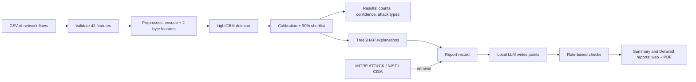

# Botnet & Network Attack Detection (UNSW-NB15)

Machine-learning detection of network attacks in recorded traffic flows, with calibrated confidence, exact model explanations and
security reports that are checked against trusted sources. The project has two parts:

1. **Research**: 23 Jupyter notebooks that build, compare and evaluate the detector on the official UNSW-NB15 split.
2. **Web application**: FastAPI + React. Upload a flow file, review the predictions, open per-flow explanations and generate a Summary or
   Detailed security report (web and PDF).

---

## Problem statement

Botnets and other network attacks hide inside large volumes of ordinary traffic. A security team needs to know **which connections look
like attacks, what kind of attack, how sure the system is, and why**, before it spends time on an investigation or blocks anything.

Most published UNSW-NB15 results report 95-99% accuracy, but they mix the official training and test files and split them at random,
which hides two real difficulties of the data:

- the official **test file was recorded differently** from the training file (distribution shift);
- many flows of different attack types have **exactly the same measurements but different labels**, so some types cannot be separated.

This project builds a detector that is evaluated honestly on the official split, says how certain each prediction is, explains it,
and turns the results into a report an analyst can act on.

## What the system does

| Step | Output |
|---|---|
| **Validate** an uploaded CSV of completed flows (42 UNSW-NB15 features) | clear errors for missing or invalid columns |
| **Detect** with a LightGBM model | Normal or one of nine attack types per flow: Analysis, Backdoor, DoS, Exploits, Fuzzers, Generic, Reconnaissance, Shellcode, Worms |
| **Calibrate** (temperature scaling) and build a **90% shortlist** (conformal prediction) | two confidences per flow: attack or normal, and exact type; a shortlist of the types the model cannot rule out |
| **Explain** with TreeSHAP | which measurements pushed the prediction towards or away from the class (exact decomposition of the model score) |
| **Report** with retrieval (RAG) and a local LLM | Summary report (4 pages, plain language) and Detailed report (evidence, sources, response plan, appendices) |

**The 5-point reasoning for each example flow** in the reports:

1. **How sure the model is**: class probability, probability that it is an attack of any type, and the 90% shortlist.
2. **Main reasons**: the measurements with the largest TreeSHAP contributions.
3. **How typical the values are**: how often the value occurs in training flows of that class versus Normal (training data only).
4. **Why not the second most likely class**: the TreeSHAP difference between the two classes.
5. **In this file**: how many uploaded flows were predicted as the same type.

The local LLM (`qwen2.5:7b` via Ollama, flows never leave the computer) writes these points from facts computed by code and from
passages retrieved from **MITRE ATT&CK, NIST SP 800-61r3, NIST SP 800-94 and the CISA incident-response playbooks**. Rule-based checks
verify every number, direction, sign, comparison, class and citation; a point that fails is written by code from the same evidence.

## Results

All scores are on the **official UNSW-NB15 test file (82,332 flows)**, which was never used for training or for choosing settings.

**Attack detection (attack vs normal, the main task)**

| Accuracy | Precision | Recall (attacks found) | F1 | Normal flows flagged |
|---|---|---|---|---|
| **86.5%** | **81.5%** | **97.6%** | **88.8%** | 27.2% |

**Attack type (10 classes)**

| Accuracy | Macro F1 | Weighted F1 | Top-2 accuracy |
|---|---|---|---|
| 74.5% | 0.541 | 0.779 | **91.2%** |

**How to read these numbers**

- **Best possible on this test file** (a model that already knows the labels): accuracy 93.6%, macro F1 0.765. Identical flows carry
  different labels, so no model can do better. For Analysis and Backdoor the best possible F1 is only 0.16 and 0.19.
- **Grouped view**: counting DoS, Analysis and Backdoor (which share measurements) as one group gives accuracy 77.0% and macro F1 0.685,
  computed from the same confusion matrix. The 10-class numbers remain the official scores.
- **Same distribution as training** (17,534 held-out training rows): attack F1 96.8%, accuracy 81.4%, macro F1 0.662. The lower test
  scores come from the shift between the two official files.
- **Model comparison (macro F1, official test file):** LightGBM v3 0.541 (deployed), LightGBM v2 0.530, LightGBM 0.512, decision tree 0.488,
  proposed Conv1D + attention network 0.473, MLP 0.450, logistic regression 0.366.

**Example upload (300 flows from the test file)**

| How sure is the model? | High (90%+) | Medium (70-90%) | Low (< 70%) |
|---|---|---|---|
| Attack or normal? | 263 | 26 | 11 |
| Exact attack type? | 92 | 57 | 151 |

The model is usually sure **whether** a flow is an attack; it is less sure **which** attack, because some types look the same.

## Workflow



**Research workflow (notebooks 01-23)**: data understanding and leakage study, preprocessing and feature engineering, baselines, a
proposed multi-scale Conv1D + cross-attention + TCN-BiLSTM network with ablation, SHAP/LIME, calibration and conformal prediction,
retrieval-grounded reports, a shift-aware detector (v2) and label-free class offsets (v3), and a final improvement round that confirmed v3.

## How to use the project

### Requirements

- Windows 10/11 (one-click scripts) or Docker
- Python 3.11 and Node.js 22
- Optional, for LLM-written explanations: [Ollama](https://ollama.com) with `ollama pull qwen2.5:7b` (about 5 GB of GPU or system memory)

### Option A: Windows (development)

1. **Model bundle.** The trained model bundle is not stored in git. Download `serving-bundle.zip` from the GitHub release into the
   `serving` folder, or build it from the trained models with `python scripts/build_serving_bundle.py`.
2. Double-click **`setup-app.cmd`** once. It installs the packages, prepares the bundle, asks for the first administrator's e-mail and
   password, and writes `backend/.env`.
3. Double-click **`start-app.cmd`**. It starts the backend and frontend and opens **http://localhost:5173**.
4. Sign in, open **Analyze Flows**, upload a CSV (or use the sample dataset), and click **Analyze Network Traffic**.
5. On the Results page, click a flow for its explanation, or **Generate Security Report**. In the report, switch between **Summary** and
   **Detailed**, open citations, record decisions in the action checklist, and download the PDFs, JSON or Markdown.

API documentation: http://localhost:8000/docs

### Option B: Docker

```bash
cp deployment/.env.example .env        # fill in the passwords and secret
docker compose up -d --build           # http://localhost:8080
```

Kubernetes manifests and the release workflow are described in [docs/DEPLOYMENT.md](docs/DEPLOYMENT.md).

### Input format

A CSV with the 42 UNSW-NB15 flow features (`dur, proto, service, state, spkts, dpkts, sbytes, dbytes, sttl, dttl, ...`). Optional
`attack_cat` / `label` columns are used only for a separate comparison after the analysis, never for the predictions.

### Run the tests

```bash
cd backend && python -m pytest -q          # backend: API, detector, reports, checks
cd frontend && npm test && npm run build   # frontend: components, report views, build
```

### Reproduce the research

1. Put the official `UNSW_NB15_training-set.csv` and `UNSW_NB15_testing-set.csv` in `data/raw/` (their SHA-256 values are checked in Notebook 01).
2. Create a Python 3.11 environment and install `requirements-research.txt` (GPU PyTorch as described at the top of the file).
3. For Notebook 18, start Ollama with `qwen2.5:7b` and download the knowledge base: `python scripts/fetch_knowledge_base.py`.
4. Build and run the notebooks:
   ```bash
   python scripts/build_v3_notebooks.py
   python scripts/run_v3_notebooks.py
   ```

## Tech stack

| Area | Tools |
|---|---|
| Machine learning | LightGBM, scikit-learn, PyTorch (compared networks), SHAP, conformal prediction |
| Reports | Ollama (qwen2.5:7b, local), TF-IDF retrieval, ReportLab PDFs |
| Backend | FastAPI, SQLAlchemy, SQLite / PostgreSQL, JWT authentication |
| Frontend | React, TypeScript, Vite, Tailwind CSS, Recharts, TanStack Query |
| Deployment | Docker, Docker Compose, Kubernetes, GitHub Actions CI/CD |

## Repository structure

```
notebooks/                    23 research notebooks (01 data understanding ... 23 final improvement round)
scripts/                      notebook sources, bundle builder, knowledge-base fetcher, setup and start scripts
src/                          shared research code (networks, final detector, explanations, retrieval)
results/                      tables and figures produced by the notebooks
backend/                      FastAPI application and tests
frontend/                     React + TypeScript web application and tests
docs/                         user guide, architecture, deployment, report schema, example reports and screenshots
deployment/, docker-compose.yml, .github/workflows/   deployment and CI/CD
setup-app.cmd, start-app.cmd  one-click local setup and start (Windows)
```

## Documentation

| Document | Contents |
|---|---|
| [docs/USER_GUIDE.md](docs/USER_GUIDE.md) | Using the application step by step |
| [docs/ARCHITECTURE.md](docs/ARCHITECTURE.md) | How the research becomes the application, with diagrams |
| [docs/DEPLOYMENT.md](docs/DEPLOYMENT.md) | Local run, Docker, Kubernetes, CI/CD, security notes |
| [docs/report_schema_v2.md](docs/report_schema_v2.md) | The report record shared by the web view, PDFs and exports |
| [docs/report_final/](docs/report_final/) | Example Summary and Detailed reports and screenshots |
| [docs/v3/README.md](docs/v3/README.md) | The research notebooks: question and main result of each |

## Limitations

- Trained and tested on UNSW-NB15 laboratory traffic; performance on other networks must be checked with labelled local traffic.
- The flow files contain no IP addresses, ports, timestamps or payloads, so hosts and timelines cannot be identified; predictions are
  not confirmed incidents.
- Analysis, Backdoor and DoS often cannot be told apart with these 42 features.
- The source checks for LLM text are rule-based (numbers, directions, citations, word overlap), not a full proof of meaning.
- The application analyses uploaded files offline; it does not capture live traffic (a flow extractor such as Argus or Zeek is needed).

## Author

**Swaraj Deogirkar**
