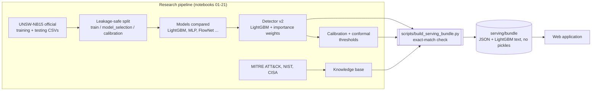
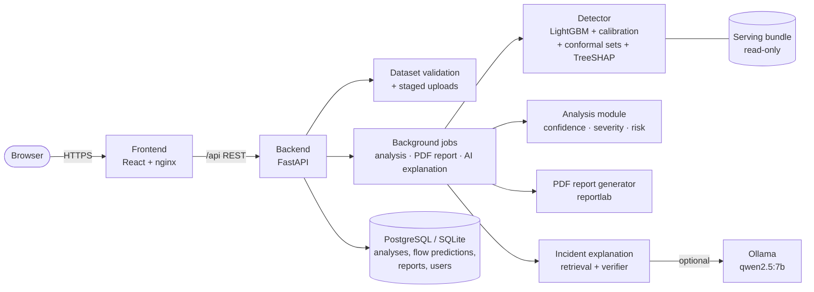
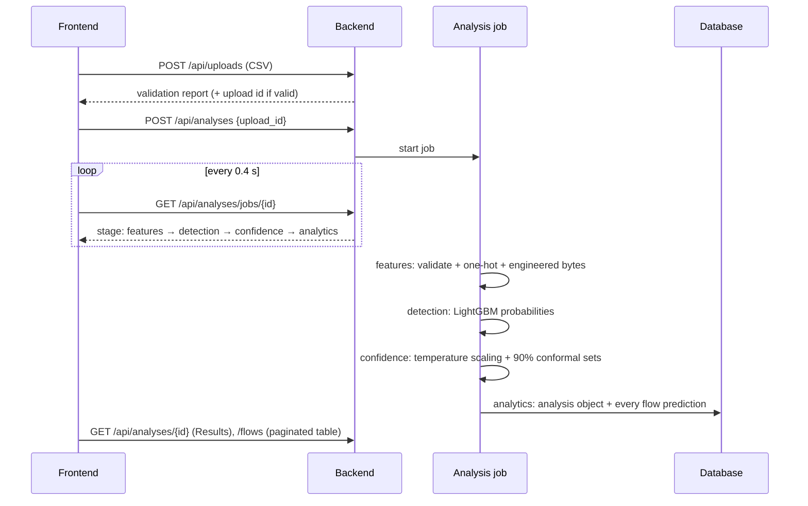
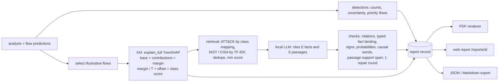

# Architecture

The project has two halves. The **research pipeline** (Notebooks 01–21) chooses, trains and tests the detector. The **web application**
serves that detector to analysts. The two are connected by one artefact: the **serving bundle**. It is built from the research models
and checked to give exactly the same predictions.

## 1. From research to application

## 2. Application components

| Component | Code | Job |
|---|---|---|
| Frontend | `frontend/src/` | Pages: Overview, Analyze Flows, Results (+ flow detail), Model, Reports, About |
| API | `backend/app/routers.py` | All routes under `/api`; every route except `health` and `auth/login` needs a signed token |
| Dataset validation | `backend/app/core/datasets.py` | File type, readability, empty file, row limit, the 42 required features, numeric / infinite / negative values, unknown categories, labels; user-facing messages only (details go to the log) |
| Analysis module | `backend/app/core/analysis.py` | **All application rules in one place**: confidence levels (≥ 90 / 70–90 / < 70%), needs review (< 70%), severity per attack class, risk rules. Builds the single analysis object used by Results, charts, the Sankey, the PDF and the Reports page |
| Detector | `backend/app/core/detector.py` | Validates and transforms the 42 features, LightGBM probabilities, temperature calibration, conformal prediction sets, TreeSHAP explanations |
| Jobs | `backend/app/jobs.py` | One worker per job kind; each job reports its real stage, which the browser polls |
| PDF reports | `backend/app/core/pdf_report.py` | Deterministic report from the stored analysis, the saved test evaluation and MITRE ATT&CK mitigations (no LLM needed) |
| Incident explanation | `backend/app/core/reports.py` | Optional per-flow explanation: evidence, retrieval, local LLM, rule-based verifier, evidence-only fallback |
| Database | `backend/app/db.py` | Analysis, FlowPrediction (every flow), AnalysisReport (PDF files under `DATA_DIR/reports`), FlowReport, User, AuditLog |

## 3. What happens when a dataset is analysed

**The analysis object** (`build_analysis`, stored in `analyses.summary`):
- totals: `total_flows`, `safe_count`, `malicious_count` and their percentages, `average_confidence`;
- distributions: `confidence_distribution`, `severity_distribution`, `attack_distribution` (count, share of malicious, average
  confidence, severity, needs review);
- `needs_review_count`, `attack_type_uncertain_count`;
- `risk` (level, matched rule, explanation), the summary cards and the `rules` themselves;
- `evaluation`, only when the file carries labels.

**Report generation** (`POST /api/analyses/{id}/report`) is a job that builds one versioned **report record** (schema 2.0, see
[report_schema_v2.md](report_schema_v2.md)) and renders the PDF from it. The web report (`/reports/{id}`), the PDF and the JSON /
Markdown exports all come from that record.

Stages reported to the UI: `detections → explanations → retrieval → generation → checks → pdf` (the middle four repeat per illustrative
flow; the detail line names the flow).

- **Illustrative flows** (`RecordBuilder.selected_flows`): the highest-confidence flow of each of the four most frequent predicted attack
  types, plus the lowest-confidence flow whose 90% set contains Normal and an attack (attack status uncertain). A Normal-only batch gets
  one Normal flow and no attack guidance. The selection rule is printed with each flow.
- **XAI** (`Detector.explain_full`): every grouped TreeSHAP contribution of the base LightGBM booster for the predicted class, its base
  value, margin, temperature and class offset, so the decomposition is exact for the deployed score. LIME is reported as not generated.
- **Retrieval** (`ReportEngine.retrieve`): passages get report-wide ids (`S#`) in a de-duplicated register with publisher, version,
  location, link, retrieval method/score and SHA-256. Passage text is untrusted data: escaped, never followed.
- **LLM and checks** (`ReportEngine.generate` / `verify`): unchanged model and prompt settings (local Ollama, temperature 0, seed 42).
  Explicit statuses (`generated`, `evidence_only_llm_unavailable`, `llm_timeout`, `llm_error`, `invalid_response`, `all_rejected`,
  `not_applicable`) replace silent fallbacks. Rejected statements are kept with their reason and round.
- **Actions** (`RecordBuilder.actions`): Verify (proposed, citing the flow evidence and a NIST detection passage), Contain if confirmed
  (LLM actions that passed the checks, citing the passage), Recover (NIST/CISA passage); each with applicability, owner, disruption and
  validation. Nothing is executed. Analysts record a status per action (`action_reviews` table, full history).
- **Storage:** `analysis_reports.record` (JSON) and `schema_version`; the PDF file under `DATA_DIR/reports`. Older schema-1 reports keep
  their PDF and `rag` data and are shown with the old threat-intelligence card.

## 4. Explanations

- **Flow explanation** (`GET /api/analyses/{id}/flows/{flow}`): exact TreeSHAP contributions from LightGBM (`pred_contrib`), added up per
  original column, so a one-hot `service=dns` counts as `service`.
- **Report explanation** (`Detector.explain_full`): the same TreeSHAP values, all columns, plus the base value, temperature and class
  offset of detector v3, so `(base + contributions) / T + offset` equals the deployed class score (checked in the tests to 1e-6).
  Percentiles shown next to values come from the training-role rows only (`feature_reference.json`).
- **Incident explanation** (`POST .../flows/{flow}/incident-report`, a background job):
  1. Evidence: the flow's values, its shortlist, the mapped ATT&CK techniques and mitigations, and NIST / CISA passages.
  2. The findings are written from the evidence.
  3. The local LLM writes (a) **prediction evidence**: why the model predicted the class, citing only E facts; and (b) techniques,
     context and actions, each citing an S source.
  4. A rule-based verifier checks every item, with one repair round. For prediction evidence it checks:
     - every number, column and class name against the cited facts;
     - the supports / argues-against direction of each column;
     - the 90% shortlist;
     - no value judgements and no pasted fact lines.

     Incomplete citations are completed and recorded. Removed items are kept with their reason.
  5. Without the LLM, or if it fails, the explanation is evidence-only.

## 5. Deployment options

| Option | Files | Use |
|---|---|---|
| Local (Windows) | `setup-app.cmd`, `start-app.cmd` | Development and demonstrations on one PC |
| docker-compose | `docker-compose.yml`, `deployment/.env.example` | One server: PostgreSQL + backend + frontend (+ Ollama with `--profile llm`) |
| Kubernetes | `deployment/kubernetes/app.yaml` | A cluster: namespace, PostgreSQL, backend, frontend |
| CI/CD | `.github/workflows/ci.yml`, `release.yml` | Every push: lint, tests, build, Docker images. Version tags: publish images to GHCR |
